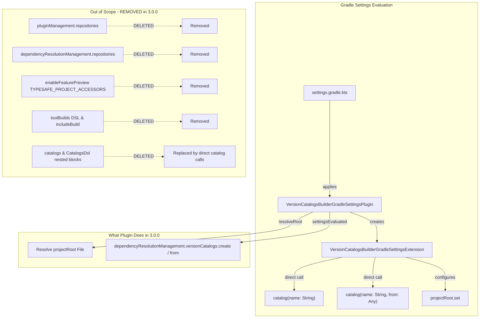

# Implementation Plan: Version Catalogs Builder 3.0.0 Scoping & Agent Paradigm

**Status:** Completed  
**Date:** 2026-11-26  
**Target:** `version-catalogs-builder-gradle-settings-plugin` (repository-wide)  
**Harness:** Antigravity  
**Model:** Gemini 3.8 Flash  
**Session:** `0118b492-57db-4b37-8fe5-8e5e5e554a4e`  

---

## 1. Executive Summary & Goals

This project (`version-catalogs-builder-gradle-settings-plugin`) grew beyond its original scope by managing repository handlers, enabling Gradle feature previews, and registering included tool builds. 

For the **3.0.0** major release:
1. **Scope Refocus:** The plugin will **ONLY build and register version catalogs**. All out-of-scope behaviors are eliminated:
   - **REMOVE** repository handler configuration (`settings.pluginManagement.repositories` and `settings.dependencyResolutionManagement.repositories`).
   - **REMOVE** feature preview enablement (`settings.enableFeaturePreview("TYPESAFE_PROJECT_ACCESSORS")`).
   - **REMOVE** composite tool builds inclusion (`toolBuilds { }` block and `settings.pluginManagement.includeBuild(...)`).
2. **Replaced API Surface:**
   Replace the previous nested DSL (`catalogs { register(...) }`, `toolBuilds { }`) with a clean, direct API surface directly on the extension:
   ```kotlin
   versionCatalogsBuilder {
     projectRoot.set(rootDir) // DirectoryProperty, defaults to auto-discovered root
     catalog("libs")
     catalog("tools", "gradle/tools.versions.toml") // resolved naturally via Settings / projectRoot
     catalog("custom", file("custom.versions.toml")) // accepts Any/File/String
   }
   ```
   - API overloads:
     - `catalog(name: String)`: defaults to `$projectRoot/gradle/$name.versions.toml`
     - `catalog(name: String, from: Any)`: accepts `String`, `File`, `Path`, `Provider`, or any notation accepted by Gradle's file resolution (resolved against `projectRoot` if relative String/File, or passed through Gradle's file notation).
   - Annotate the extension with `@DslMarker` (`@VersionCatalogsBuilderDsl`) to prevent receiver leakage.
3. **ai-job-tracker Verification:**
   - Verify that use within `/Users/fnc314/Code/ai/ai-job-tracker` does not rely on repositories or typesafe project accessors being injected by this plugin. (Verified: `ai-job-tracker` explicitly declares its own repositories, feature previews, and included builds in root and nested settings files, and uses its own `SubsystemSettingsPlugin`).
4. **Agent Infrastructure & Planning Paradigm:**
   - Create `.agents/plans/` directory with `README.md` (index/registry) and `TEMPLATE.md` mirrored from `/Users/fnc314/Code/ai/ai-job-tracker/.agents/plans/`.
   - Store this 3.0.0 plan in `.agents/plans/2026-11-26/004500_version-catalogs-builder-3-0-0-scope-reduction.md` and register it in `.agents/plans/README.md`.
   - Author a root `AGENTS.md` establishing agent guidelines, plan creation invariants, KDoc enforcement, and testing standards tailored to this repository.
5. **README.md and Documentation Updates:**
   - Update `README.md` completely to reflect the 3.0.0 streamlined API, removal of repository/tool-build features, and natural file resolution examples.
   - Update KDocs across all plugin and extension classes.
6. **Prepare (Do Not Publish) 3.0.0:**
   - Update `gradle/libs.versions.toml` project version to `3.0.0`.
   - Update tests, samples, and documentation to reflect the 3.0.0 API.
   - Ensure `./gradlew check` passes without publishing artifacts.

---

## 2. Architecture & Design Principles

### Scope Boundary


### Streamlined API Surface & DSL Marker
```kotlin
@DslMarker
@Target(AnnotationTarget.CLASS, AnnotationTarget.TYPEALIAS)
@Retention(AnnotationRetention.BINARY)
public annotation class VersionCatalogsBuilderDsl

@VersionCatalogsBuilderDsl
public open class VersionCatalogsBuilderGradleSettingsExtension @Inject constructor(
  objects: ObjectFactory,
) {
  public val projectRoot: DirectoryProperty = objects.directoryProperty()

  internal val catalogsList: MutableMap<String, Any?> = mutableMapOf()

  /**
   * Registers a version catalog by [name], defaulting to `gradle/{name}.versions.toml` relative to [projectRoot].
   *
   * @param name Name of the version catalog accessor (e.g. `"libs"`, `"tools"`).
   */
  public fun catalog(name: String) {
    catalogsList[name] = null
  }

  /**
   * Registers a version catalog by [name] with an explicit [from] path or file reference.
   *
   * Accepts any argument supported by Gradle file notation (`String`, `File`, `Path`, etc.).
   * Relative paths are resolved relative to [projectRoot].
   *
   * @param name Name of the version catalog accessor.
   * @param from File, relative path string, or notation pointing to the TOML catalog file.
   */
  public fun catalog(name: String, from: Any) {
    catalogsList[name] = from
  }
}
```

In `VersionCatalogsBuilderGradleSettingsPlugin.kt`, when resolving `from`:
- If `from == null`: resolve `File(rootDir, "gradle/$name.versions.toml")`
- If `from is File`: if absolute, use directly; if relative, resolve `File(rootDir, from.path)`
- If `from is String`: if absolute file path, use directly; otherwise resolve relative to `rootDir` (or via `settings.file(from)`)
- Otherwise pass to `settings.file(from)` / `settings.layout.settingsDirectory.file(...)` or `rootDir.resolve(...)`
- Then register into `dependencyResolutionManagement.versionCatalogs.create(name) { it.from(file) }`.

---

## 3. Verification of `ai-job-tracker`

We examined `ai-job-tracker`:
- `/Users/fnc314/Code/ai/ai-job-tracker/settings.gradle.kts` explicitly declares:
  ```kotlin
  enableFeaturePreview("TYPESAFE_PROJECT_ACCESSORS")
  pluginManagement {
    repositories {
      google()
      mavenCentral()
      gradlePluginPortal()
    }
    includeBuild(...)
  }
  dependencyResolutionManagement {
    repositories {
      google()
      mavenCentral()
    }
  ...
  ```
- All nested tool builds (`gradle/tools/plugins-settings`, `plugins-docs`, `plugins-projects`) explicitly define their own `pluginManagement` and `dependencyResolutionManagement` repository blocks and include builds.
- Conclusion: `ai-job-tracker` did not and will not rely upon `version-catalogs-builder` to configure repositories or enable feature previews. The stripped-down 3.0.0 is completely safe and cleanly decouples catalog resolution.

---

## 4. Proposed Changes & Implementation Steps

Grouped by component:

### Component 1: Core Plugin & Extension (`plugin/`)

#### [NEW] `plugin/src/main/kotlin/dev/fnc314/gradle/plugins/settings/versioncatalogsbuildergradlesettingsplugin/VersionCatalogsBuilderDsl.kt`
- Create `@DslMarker public annotation class VersionCatalogsBuilderDsl`.

#### [MODIFY] `plugin/src/main/kotlin/dev/fnc314/gradle/plugins/settings/versioncatalogsbuildergradlesettingsplugin/VersionCatalogsBuilderGradleSettingsExtension.kt`
- Replace entire nested DSL with direct methods:
  - `projectRoot: DirectoryProperty`
  - `catalog(name: String)`
  - `catalog(name: String, from: Any)`
- Annotate extension with `@VersionCatalogsBuilderDsl`.
- Delete `CatalogsDsl`, `ToolBuildsDsl`, and `toolBuilds`.
- Update KDocs.

#### [MODIFY] `plugin/src/main/kotlin/dev/fnc314/gradle/plugins/settings/versioncatalogsbuildergradlesettingsplugin/VersionCatalogsBuilderGradleSettingsPlugin.kt`
- Remove `settings.enableFeaturePreview("TYPESAFE_PROJECT_ACCESSORS")`.
- Remove `settings.pluginManagement.repositories { ... }`.
- Remove `settings.dependencyResolutionManagement.repositories { ... }`.
- Remove tool builds inclusion loop in `settingsEvaluated`.
- Retain root resolution and version catalog registration (`dependencyResolutionManagement.versionCatalogs`) using natural `settings.file(...)` / root resolution.
- Update KDocs.

#### [MODIFY] `gradle/libs.versions.toml`
- Bump `project = "3.0.0"`.

---

### Component 2: Tests, Samples & Documentation

#### [MODIFY] `README.md`
- Comprehensive rewrite of `README.md`:
  - Detail 3.0.0 single-responsibility philosophy: version catalogs ONLY.
  - Update code snippets to show direct `catalog("libs")` and `catalog("tools", "gradle/tools.versions.toml")` or `catalog("custom", file(...))`.
  - Remove all documentation regarding repositories, feature previews, and `toolBuilds`.
  - Document environment variable fallbacks (`VERSION_CATALOGS_BUILDER_ROOT`, `WORKSPACE_ROOT`).

#### [MODIFY] `plugin/src/functionalTest/kotlin/dev/fnc314/gradle/plugins/settings/versioncatalogsbuildergradlesettingsplugin/VersionCatalogsBuilderGradleSettingsPluginFunctionalTest.kt`
- Update test settings to use:
  ```kotlin
  versionCatalogsBuilder {
    catalog("libs")
  }
  ```
- Ensure repositories are configured in test project if needed.

#### [DELETE] `samples/composite-tool-builds/`
- Remove this sample because `toolBuilds` is no longer part of this plugin.

#### [MODIFY] `samples/basic-multi-catalog/settings.gradle.kts`
- Update syntax:
  ```kotlin
  versionCatalogsBuilder {
    catalog("libs")
    catalog("tools", "gradle/tools.versions.toml")
  }
  ```
- Add standard repositories block in sample settings if needed.

#### [MODIFY] `samples/custom-root-monorepo/packages/service-api/settings.gradle.kts`
- Update syntax to `versionCatalogsBuilder { catalog(...) }`.

#### [MODIFY] `plugin/src/functionalTest/kotlin/dev/fnc314/gradle/plugins/settings/versioncatalogsbuildergradlesettingsplugin/SamplesExecutionFunctionalTest.kt`
- Remove `testCompositeToolBuildsSample`.
- Update assertions for remaining samples.

---

### Component 3: Agent Infrastructure & Documentation (`.agents/` and `AGENTS.md`)

#### [NEW] `.agents/plans/README.md`
- Create plan index table following `ai-job-tracker` pattern.
- Invariants: Target-derived location, date subdirectory (`YYYY-MM-DD`), 24-hr timestamp prefix (`HHMMSS_<plan-name>.md`), registry synchronization, mandatory frontmatter.

#### [NEW] `.agents/plans/TEMPLATE.md`
- Mirrored from `ai-job-tracker` plan template:
  - Frontmatter: Status, Date, Target, Harness, Model, Session.
  - Sections: 1. Executive Summary & Goals, 2. Architecture & Design Principles, 3. Proposed Changes & Implementation Steps, 4. Verification Plan & Testing Checklist, 5. Bookkeeping.

#### [NEW] `.agents/plans/2026-11-26/004500_version-catalogs-builder-3-0-0-scope-reduction.md`
- Persist this implementation plan into the repository registry under the new paradigm and link in `.agents/plans/README.md`.

#### [NEW] `AGENTS.md`
- Author repository agent guidelines:
  - Project Scope: Version catalogs builder ONLY.
  - Planning Paradigm: Mandatory `.agents/plans/` invariants, timestamped files, TEMPLATE.md frontmatter, and README.md registry sync.
  - Code & Quality Standards: KDocs on all public declarations, 2-space indentation, Gradle Isolated Projects readiness, explicit API mode.
  - Verification & Safety: `./gradlew check` verification, no unapproved publishing.

---

## 5. Verification Plan

### Automated Tests
- Run `./gradlew check` (unit tests, `validatePlugins`, functional tests via `GradleRunner`).
- Run samples functional tests.

### Manual Verification
- Verify that `VersionCatalogsBuilderGradleSettingsExtension` has `@VersionCatalogsBuilderDsl`.
- Verify no references to `repositories`, `toolBuilds`, or `enableFeaturePreview` remain in plugin sources or documentation.
- Verify `README.md` cleanly showcases the new 3.0.0 API.
- Verify `git status` shows version `3.0.0` prepared and no publication tasks run.
